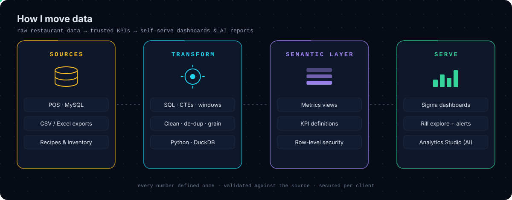
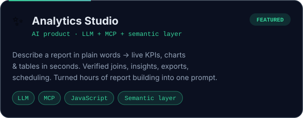
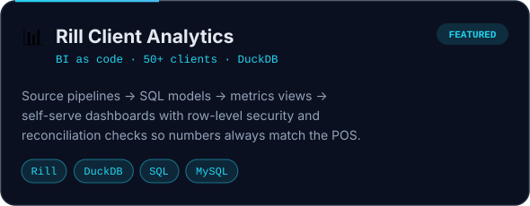

<!-- ═══════════════════════════  HEADER  ═══════════════════════════ -->

  

  <a href="https://github.com/suyogpatil395">
    <picture>
      <source media="(prefers-color-scheme: dark)" srcset="https://readme-typing-svg.demolab.com?font=Fira+Code&weight=600&size=22&duration=2800&pause=800&center=true&vCenter=true&width=900&height=50&lines=Data+Engineer+%40+FoodBot+AI;Sigma+%26+Rill+for+50%2B+restaurant+clients;Built+Analytics+Studio+%E2%80%94+AI+reports;SQL+%E2%80%A2+Python+%E2%80%A2+DuckDB+%E2%80%A2+Semantic+layers;Raw+data+%E2%86%92+trusted+KPIs+%E2%86%92+decisions;Open+to+Data+Engineer+roles&color=22D3EE" />
      <source media="(prefers-color-scheme: light)" srcset="https://readme-typing-svg.demolab.com?font=Fira+Code&weight=600&size=22&duration=2800&pause=800&center=true&vCenter=true&width=900&height=50&lines=Data+Engineer+%40+FoodBot+AI;Sigma+%26+Rill+for+50%2B+restaurant+clients;Built+Analytics+Studio+%E2%80%94+AI+reports;SQL+%E2%80%A2+Python+%E2%80%A2+DuckDB+%E2%80%A2+Semantic+layers;Raw+data+%E2%86%92+trusted+KPIs+%E2%86%92+decisions;Open+to+Data+Engineer+roles&color=6D28D9" />
      
    </picture>
  </a>

  
  
  
  

<!-- ═══════════════════════════  ABOUT  ═══════════════════════════ -->
<h2>
  
  Hey, I'm Suyog
</h2>

I turn **messy restaurant POS data into numbers people trust**, then make those numbers self-serve. I own the BI platforms at **FoodBot AI** end to end, from source pipelines and SQL models to the semantic layer, dashboards and an AI product on top.

  

  

<!-- ═══════════════════════════  WORK  ═══════════════════════════ -->
<h2>
  
  What I work on
</h2>

<table>
<tr>
<td width="33%" valign="top">

### Sigma Computing
**100% ownership**

- Client dashboards from requirement to delivery
- **Custom SQL** for complex, multi-source analysis
- Data models, workbooks, reusable metrics
- **Row-level security**, users, schedules, alerts

</td>
<td width="33%" valign="top">

### Rill Data
**migration + 100% ownership**

- Migrated client reporting to Rill on **DuckDB**
- Sources → SQL models → **metrics views** → dashboards
- RLS, users and target-based alerts
- Reconciliation checks: dashboard = POS

</td>
<td width="33%" valign="top">

### Analytics Studio
**AI product, built from scratch**

- Plain-language request → live report
- LLM plans, **MCP** fetches, semantic layer governs
- Verified joins, insights, exports, scheduling
- **Hours of report building → one prompt**

</td>
</tr>
</table>

  

<!-- ═══════════════════════════  PROJECTS  ═══════════════════════════ -->
<h2>
  
  Featured projects
</h2>

  
  

<b>More projects</b>

 

| Project | What it is |
|---|---|
| [ICC Men's T20 World Cup Analytics](https://github.com/suyogpatil395/-ICC-Men-s-T20-Cricket-World-Cup-Data-Analytics) | T20 World Cup data analysis with an interactive Power BI dashboard (Python notebooks) |
| [Smart Inquiry Automation](https://github.com/suyogpatil395/Smart-inquiry-automation) | Automating inquiry handling |
| [75 Days Data Challenge](https://github.com/suyogpatil395/75-Days-Data-Challenge) | 75 days of hands-on data practice |
| [Power BI dashboards](https://github.com/suyogpatil395/PowerBI-Dashboard-2-Suyog-Store--Ecommerce-Sales-Dashboard) | E-commerce sales and population dashboards |

<!-- ═══════════════════════════  STACK  ═══════════════════════════ -->
<h2>
  
  Tech stack
</h2>

  

<table align="center">
<tr><td><b>🗄️ Data & SQL</b></td><td>

</td></tr>
<tr><td><b>📐 Modeling</b></td><td>

</td></tr>
<tr><td><b>📊 BI</b></td><td>

</td></tr>
<tr><td><b>🤖 AI</b></td><td>

</td></tr>
<tr><td><b>🌱 Learning</b></td><td>

</td></tr>
</table>

<!-- ═══════════════════════════  STATS  ═══════════════════════════ -->
<h2>
  
  GitHub activity
</h2>

  
  

  <picture>
    <source media="(prefers-color-scheme: dark)" srcset="https://raw.githubusercontent.com/suyogpatil395/suyogpatil395/output/activity-dark.svg" />
    <source media="(prefers-color-scheme: light)" srcset="https://raw.githubusercontent.com/suyogpatil395/suyogpatil395/output/activity-light.svg" />
    
  </picture>

  <picture>
    <source media="(prefers-color-scheme: dark)" srcset="https://raw.githubusercontent.com/suyogpatil395/suyogpatil395/output/github-snake-dark.svg" />
    <source media="(prefers-color-scheme: light)" srcset="https://raw.githubusercontent.com/suyogpatil395/suyogpatil395/output/github-snake.svg" />
    
  </picture>

<!-- ═══════════════════════════  FOOTER  ═══════════════════════════ -->

  
  &nbsp;<b><code>SELECT insight FROM data WHERE trust = 'validated';</code></b>&nbsp;
  

  

